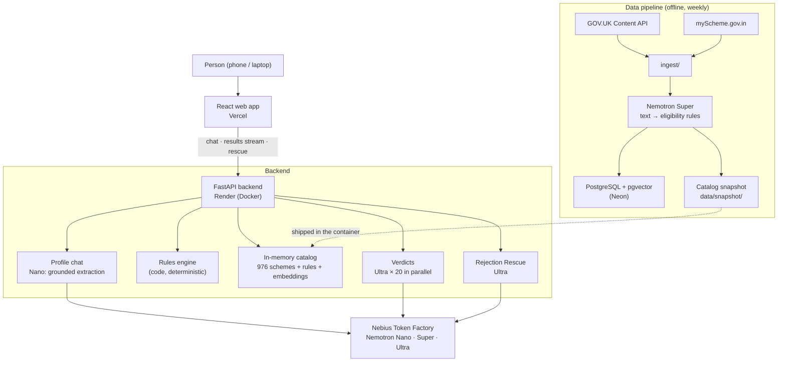

# Haq — हक़ · what's yours

**An AI caseworker that finds the government benefits you're entitled to, explains exactly why, tells you how to claim them — and helps you appeal when you're rejected.**

Built for the **Nebius × NVIDIA Global AI Hackathon** · Track: **Best Apps & Agents**
All reasoning runs on **NVIDIA Nemotron 3 (Nano, Super, Ultra) via Nebius Token Factory**.

| | |
|---|---|
| 🌐 Live app | **https://haq-alpha.vercel.app** |
| ⚙️ Live API | https://haq-api.onrender.com · [interactive docs](https://haq-api.onrender.com/docs) |
| 🎬 Demo video | _link coming soon_ |

> The free backend sleeps after 15 minutes without visitors. If the first answer is slow, it is waking up (about a minute).

---

## The problem

Billions in government benefits go unclaimed every year — not because people don't qualify, but because
they don't know the scheme exists, can't decode the eligibility rules, or give up after a rejection letter.
India alone lists 4,000+ central and state schemes; the UK has dozens of overlapping benefits. The people who
need them most have the least time to read official guidance written for lawyers.

## What Haq does

1. **Pick your country, state and language, then tell it about yourself in your own words** — English, Hinglish, Hindi, Marathi or Bengali, as you'd talk to a person. The welcome screen shows popular and recently launched schemes and browsable categories (no AI, from `GET /api/highlights`).
   *"Main 20 saal ki hoon, BA kar rahi hoon, hum OBC hain, ghar ki income 1.5 lakh hai."*
2. **It asks only what's missing** (at most 3 short questions, with tap-to-answer buttons).
3. **It checks ~1,000 official schemes** and shows what you're likely entitled to, with:
   - an estimated yearly amount (₹ / £),
   - every requirement checked against your situation (✓ / ✗ / ?), in plain words,
   - the documents to gather, the steps to apply, and the official source.
4. **Rejection Rescue:** paste or photograph a rejection letter. Haq explains each reason, checks it
   against the official rules, says whether to fix-and-reapply or appeal, finds the deadline, and drafts
   a formal appeal letter.

Two countries, one engine: **UK** (GOV.UK, 86 benefits) and **India** (Uttar Pradesh, Bihar and 729 central
schemes from myScheme.gov.in).

**Example results (live, Oct 2026):**
- *Bihar, 20, OBC, BA student, family income ₹1.5 lakh* → ₹68,000/year from 17 schemes, led by the
  Post-Matric Scholarship (Bihar) and the central OBC Post-Matric Scholarship — including the detail
  *"the two-sons limit doesn't apply to daughters"*, found by Nemotron Ultra in the official text.
- *UK, single mum of two, £900/month* → Universal Credit (eligible, ~£12,393/year for two children),
  Council Tax Reduction, Child Benefit and more.

---

## How it uses NVIDIA Nemotron on Nebius Token Factory

Each model does the job it's best at — fast models for every chat turn, the strongest model for decisions:

| Model (Token Factory ID) | Job in Haq | Settings | Why this model |
|---|---|---|---|
| **Nemotron 3 Nano** `nvidia/NVIDIA-Nemotron-3-Nano-30B-A3B` | Turns each chat message into a structured profile (age, state, income, category, occupation, children…) | thinking **off**, strict JSON schema | Runs on every message — must answer in ~1–3 s. Understands Hinglish ("20 saal **ki** hoon" → female). |
| **Nemotron 3 Super** `nvidia/nemotron-3-super-120b-a12b` | Offline: converted the eligibility text of all 976 schemes into structured rules | thinking on, Pydantic-validated JSON | Long official text, careful reading, one-time job (976/976 succeeded) |
| **Nemotron 3 Ultra** `nvidia/Nemotron-3-Ultra-550b-a55b` | Final eligibility verdict + plain-language explanation for each shortlisted scheme; Rejection Rescue analysis and appeal letters | thinking on, strict JSON schema, 20 calls in parallel | The decisions that matter most — subtle conditions, exceptions, explanations people can trust |

Helpers on Token Factory (no NVIDIA model was available for these):
`Qwen/Qwen3-Embedding-8B` for search embeddings, and `google/gemma-3-27b-it` only to read the text off a
photo of a letter — all understanding and decisions stay with Nemotron.

**How Token Factory helped:** one OpenAI-compatible API for every model (the official `openai` SDK with a
different `base_url` — no custom client), so we could route each task to the right Nemotron size, run
20 Ultra calls in parallel for one results page, switch reasoning off per call for latency, and use strict
`json_schema` structured output everywhere. Detailed notes: [docs/feedback.md](docs/feedback.md).

---

## Architecture



**What happens when you ask:**

```
"Main 20 saal ki hoon, BA kar rahi hoon…"
   ↓  Nemotron Nano → profile (every fact must quote your words; code checks the quote and does the maths)
   ↓  Rules engine (code) → 824 schemes for Bihar + national, 221 clearly ruled out
   ↓  Ranking: meaning similarity to your profile + bonus for confirmed rules; 5 slots reserved for state schemes
   ↓  Top 20 → Nemotron Ultra in parallel → verdict, fit, reasons, amount (streamed to the page one by one)
Results page opens in seconds and fills in as each verdict arrives.
```

### Design decisions

- **Never wrongly exclude someone.** Telling an eligible person "you don't qualify" is the worst mistake Haq can
  make. Hard rules in code only say *fail* when certain; unknown facts stay *unknown*. Extracted rules keep
  OR-conditions as text and use the loosest limit when it varies by group.
- **Code for what's certain, AI for what needs understanding.** Income limits, ages, units ("1.5 lakh", "£900 a month",
  "2 bigha") and tapped buttons are handled in code. Follow-up questions are templates. The models read people
  and official text.
- **Grounded extraction.** With reasoning off, a fast model can invent facts. Every extracted fact must quote the
  person's own words; code verifies the quote and that any number appears in it. Result: ~2 s per chat turn
  instead of ~11 s, with no invented facts in our tests.
- **Answers are grounded in official text.** Every result links to its official source; Ultra only judges from
  the official eligibility text it is given.
- **Privacy by design.** The server stores nothing: the browser keeps the profile and sends it with each request.
  Aadhaar, PAN, National Insurance and account numbers are removed before any text reaches a model.
- **No database on the request path.** The catalog (schemes + rules + embeddings, ~12 MB) ships inside the
  container and similarity is computed in memory — the API starts in ~1 s and doesn't depend on a sleeping
  free database. PostgreSQL + pgvector remain the data pipeline's store.

---

## Tech stack

| Layer | Tech |
|---|---|
| Frontend | React 19, TypeScript, Vite, Tailwind CSS — mobile-first, UI in English, Hinglish, Hindi, Marathi, Bengali; countries in `web/src/config/countries.ts` |
| Backend | Python 3.13, FastAPI, Pydantic, NumPy, NDJSON streaming |
| AI | NVIDIA Nemotron 3 Nano / Super / Ultra on Nebius Token Factory (OpenAI-compatible API) |
| Data | GOV.UK Content API, myScheme.gov.in; PostgreSQL + pgvector (Neon) |
| Hosting | Vercel (frontend), Render (backend, Docker) |
| Tests | pytest (46 tests: rules engine, grounded extraction, privacy, follow-ups, CORS) |

## Project structure

```
api/            FastAPI app: /api/profile, /api/results(/stream), /api/rescue, /api/health
core/           The engine: profile + grounded extraction, rules engine, candidates, verdicts, rescue, catalog
ingest/         Download UK + India schemes, extract eligibility rules with Nemotron Super
db/             PostgreSQL schema + loader, catalog snapshot builder
data/           processed/ (schemes, rules), manual/ (hand-checked fixes), snapshot/ (what the API runs on)
web/            React frontend
scripts/        Smoke tests and demos (Nemotron check, search, profile chat, results, rescue)
tests/          Unit tests
docs/           User stories, deployment guide, Nebius/NVIDIA feedback
```

---

## Run it locally

Requirements: Python 3.11+, Node 20+, a Nebius Token Factory API key.

```bash
python -m venv .venv
.venv\Scripts\activate              # Windows  (macOS/Linux: source .venv/bin/activate)
pip install -r requirements.txt
cp .env.example .env                # add NEBIUS_API_KEY
cd web && npm install && cd ..
```

Start both servers (Windows, one command — opens the app when ready):

```bash
powershell -ExecutionPolicy Bypass -File dev.ps1
```

Or in two terminals:

```bash
python -m uvicorn api.main:app --port 8000     # backend  → http://localhost:8000/docs
cd web && npm run dev                          # frontend → http://localhost:5173
```

The repo includes the catalog snapshot, so no database is needed to run the app.

Checks:

```bash
pytest                              # unit tests
python -m scripts.check_llm         # Nemotron models reachable, Hinglish extraction, tool calling
python -m scripts.try_results Priya # full pipeline for a demo persona (Priya | Ramesh | Sarah)
python -m scripts.try_rescue        # Rejection Rescue on two fictional sample letters
```

### Rebuilding the data (optional)

```bash
python -m ingest.uk                 # UK benefits from the GOV.UK Content API  → data/processed/uk.json
python -m ingest.india              # UP, Bihar + central schemes from myScheme → data/processed/india.json
python -m ingest.extract_rules      # Nemotron Super: eligibility text → rules → data/processed/rules.json
python -m db.load                   # PostgreSQL + pgvector (needs DATABASE_URL)
python -m db.snapshot               # catalog snapshot the API runs on → data/snapshot/
```

Deployment: [docs/deploy.md](docs/deploy.md).

---

## What was built during the hackathon

Everything. The repository started on 11 October 2026: data ingestion, rule extraction, the rules engine,
grounded profile extraction, streaming results, Rejection Rescue, the React app and the deployment.
The backlog we worked from is in [docs/user-stories.md](docs/user-stories.md).

## Limitations

- Guidance only, not an official decision — always confirm on the official website before applying.
- India covers Uttar Pradesh, Bihar and central schemes; other states see central schemes only.
- Scheme data is a snapshot (refreshed by re-running the pipeline); myScheme's page for Ayushman Bharat
  PM-JAY was broken, so that entry was written by hand from public information.
- Ultra's verdict on borderline schemes can differ between runs (e.g. "likely" vs "check a few things").

## Data sources and attribution

- UK: [GOV.UK](https://www.gov.uk) content, licensed under the [Open Government Licence v3.0](https://www.nationalarchives.gov.uk/doc/open-government-licence/version/3/).
- India: [myScheme.gov.in](https://www.myscheme.gov.in), Government of India — reproduced with attribution.

## License

[MIT](LICENSE)
